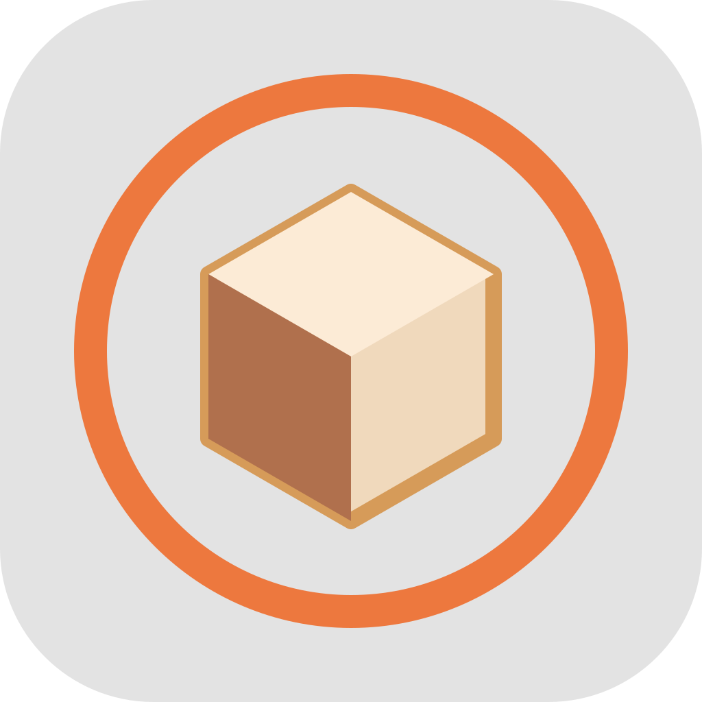

<p align="center"></p>

# Krouton

Krouton is a native Mac app for making CDs, DVDs and Blu-ray discs. It writes data discs that open on any computer, burns already-authored DVD and Blu-ray video, puts high-definition video on a DVD (AVCHD), makes audio CDs with CD-Text and shaped crossfades, makes MP3 CDs for the car, copies disc images, rescues damaged discs and prints disc labels. With **Krouton Server** it can also burn on a drive attached to another computer.

Krouton is written in Swift 6 and SwiftUI and is MIT licensed. It is meant to keep working long after the big disc-burning apps have gone.

- Website: [krouton.app](https://krouton.app)
- User manual: [krouton.app/manual](https://krouton.app/manual/), also built into the app (Help › Krouton User Manual, ⌘?)
- Optical disc archive (specs, drivers, longevity data): [archive.krouton.app](https://archive.krouton.app)

<!-- Screenshots go here once they exist (docs/assets/screenshots/). Don't add mock-ups. -->

## Status

Krouton has no published release yet; build it from source.

These work today: data discs, audio CDs, MP3 CDs, disc-image burns, sector-for-sector disc copies, Blu-ray video, tagged ripping, video extraction, damaged-disc rescue, AVCHD, labels, the Depot, Krouton Server, the `krouton` command and the Shortcuts actions.

Still being built: several legacy formats (Video CD, Photo CD) and DVD and Blu-ray menu authoring. Krouton refuses to burn those formats rather than write the wrong disc. The manual's [Getting started](https://krouton.app/manual/getting-started/) chapter keeps the current list.

## Requirements

- To run: macOS 14 Sonoma or later.
- To build: Xcode 27.2 with Swift 6.4. CI selects it on the `xcode-27` runner image with [`Scripts/ci-select-xcode.sh`](Scripts/ci-select-xcode.sh), and builds with warnings as errors.
- Optional: `ffmpeg` (Homebrew) for the video workflows.
- Optional: [XcodeGen](https://github.com/yonaskolb/XcodeGen) for the Xcode project (widget and App Intents).
- Krouton Server: Rust 1.88 or later.

## Build and run

```bash
git clone https://github.com/jigaz/Krouton.git
cd Krouton
swift build                 # all targets
swift run Krouton           # the app
swift run Krouton --help    # the command-line tool
```

Before sending a change, run the gates. [CONTRIBUTING.md](CONTRIBUTING.md) explains each one.

```bash
swift test && swift run krouton-verify
python3 Scripts/build-manual.py --check
python3 Scripts/extract-strings.py --check
```

### The Xcode project

SwiftPM builds the app on its own. The Xcode project adds what SwiftPM can't build: the desktop widget extension and the App Intents metadata for Shortcuts, Siri and Spotlight. The project is generated from [`XcodeHost/project.yml`](XcodeHost/project.yml) and isn't committed.

```bash
brew install xcodegen
cd XcodeHost && xcodegen generate
open Krouton.xcodeproj
```

The project signs automatically with the owner's team. To build a signed copy, set your own team in Xcode; to build unsigned, pass `CODE_SIGNING_ALLOWED=NO` to `xcodebuild`, as CI's `xcode-app` job does.

## Packaging the app

```bash
./Scripts/bundle-app.sh                   # this Mac's architecture
ARCH=x86_64 VERSION=1.1.0 ./Scripts/bundle-app.sh
```

This writes `dist/macos-<arch>/Krouton.app` and `dist/Krouton-<version>-macOS-<arch>.zip`. It signs with a Developer ID certificate when one is in the keychain (ad hoc otherwise) and prints the zip's SHA-256 for the Homebrew cask in `Packaging/Homebrew/Casks/`. The formula in `Packaging/Homebrew/Formula/` installs the command-line tool and its man page.

## Krouton Server

[`krouton-server/`](krouton-server/README.md) is a small Rust server for a Raspberry Pi, Linux box, Proxmox host, NAS, Windows 10 or 11 PC, or older Mac with a burner attached. Pair it once from **Settings › Burners & Network**, then add it as a destination. It burns disc images, and builds discs from folders the app sends. Set `backend = simulate` in its `server.conf` to try it without a burner.

```bash
cd krouton-server
cargo test --workspace
cargo clippy --workspace --all-targets
```

## Repository map

| Path | What it is |
|---|---|
| `Sources/` | The Swift package: ten library modules, the app (`KroutonApp`, a library started by `KroutonMain`) and the verification harness (`KroutonVerify`). See [ARCHITECTURE.md](ARCHITECTURE.md). |
| `Sources/KroutonApp/Resources/Manual/` | The user manual in Markdown. The app shows it; `Scripts/build-manual.py` renders it into `docs/manual/`. |
| `Tests/` | XCTest targets, one per module plus one for the harness. |
| `krouton-server/` | Krouton Server (Rust): the `krsp` protocol crate, `server-core`, the binary and installers. |
| `Vectors/` | Golden test vectors for the KRSP protocol, folder bundles and the UDF writer, checked by both Swift and Rust. |
| `XcodeHost/` | The Xcode project spec (`project.yml`), the app's entry point, the widget extension, Info.plist and entitlements. |
| `docs/` | The krouton.app website (GitHub Pages). |
| `Packaging/` | Homebrew cask and formula, man page. |
| `Scripts/` | Build, packaging, manual, string catalog and CI helper scripts. |
| `KroutonPaletteKit/` | The locked colour palette the interface is drawn from. |
| `dev-notes/` | Notes for contributors: open questions, plans, how agents work here; indexed in its README. |
| `PENDING_INTEGRATION.md` | Public types that have no caller yet, each with an owner and a date. |

## Contributing

Contributions are welcome, and you can test most of the app without a burner. Start with [CONTRIBUTING.md](CONTRIBUTING.md). It covers the build, the gates, where things live and how to pick something to work on. You can also help without writing code: burn a disc and [send a drive report](https://krouton.app/drives/).

## Documentation

- [ARCHITECTURE.md](ARCHITECTURE.md): modules, dependency rules and the verification suites
- [CONTRIBUTING.md](CONTRIBUTING.md): how to build, test and send a change
- [SECURITY.md](SECURITY.md): reporting vulnerabilities and the network threat model
- [CHANGELOG.md](CHANGELOG.md): what changed
- [CODE_OF_CONDUCT.md](CODE_OF_CONDUCT.md)
- [CLAUDE.md](CLAUDE.md): the same rules, written for AI coding agents

## License

MIT. See [LICENSE](LICENSE).
